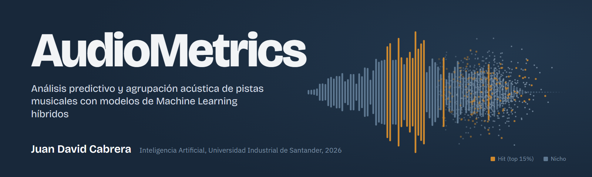

# AudioMetrics

**Análisis predictivo y agrupación acústica de pistas musicales mediante modelos de Machine Learning híbridos**

Proyecto final de Inteligencia Artificial, Universidad Industrial de Santander (UIS), 2026.

## Integrantes

- Juan David Cabrera

## Objetivo del proyecto

Construir un pipeline de inteligencia artificial en cascada que, a partir de las variables acústicas de una canción (energía, bailabilidad, tempo, acústica, etc.), responda tres preguntas:

1. **¿A qué perfil acústico pertenece?** Clustering no supervisado con PCA, K-Means y DBSCAN.
2. **¿Será un "Hit" o una pista de "Nicho"?** Clasificación binaria, donde Hit es estar en el top 15% de popularidad.
3. **¿Qué puntaje de popularidad (0-100) tendría?** Regresión (trabajo futuro).

El objetivo final es llevar este pipeline a una aplicación web donde el usuario ingrese las variables de su canción y obtenga las tres respuestas en tiempo real.

## Dataset

**Spotify Tracks Dataset** (Maharshi Pandya, Kaggle): 114,000 canciones de 114 géneros con su popularidad y las variables de audio de Spotify.

https://www.kaggle.com/datasets/maharshipandya/-spotify-tracks-dataset

Para ejecutar el notebook en Google Colab, descarga `dataset.csv` desde Kaggle y súbelo a la sesión antes de correr la primera celda de código.

## Contenido del repositorio

| Archivo | Descripción |
|---|---|
| [`AudioMetrics_Entrega3.ipynb`](AudioMetrics_Entrega3.ipynb) | Notebook acumulativo (entregas 1, 2 y 3), ejecutado y con salidas |
| [`docs/AudioMetrics_Diapositivas.pdf`](docs/AudioMetrics_Diapositivas.pdf) | Diapositivas del proyecto |
| [`assets/banner.png`](assets/banner.png) | Banner del proyecto |

## Resumen de resultados

**Entrega 1: preprocesamiento y análisis exploratorio.** Limpieza (outliers con IQR, nulos, duplicados), One-Hot de género y definición de la etiqueta Hit por percentil 85 (`popularity > 57`).

**Entrega 2: clasificación Hit / Nicho** (test del 20%, métrica principal F1 de la clase Hit):

| Modelo | Configuración | F1 Hit | Precisión | Recall |
|---|---|---|---|---|
| Decision Tree | `max_depth = 60` | 0.42 | 0.30 | 0.69 |
| **Random Forest** | `n_estimators = 100` | **0.52** | **0.41** | 0.71 |
| SVM | `kernel = poly` | 0.50 | 0.35 | 0.85 |
| MLP (Keras) | 3 capas, 10 epochs | 0.50 | 0.36 | 0.86 |

**Entrega 3: clustering acústico.** StandardScaler, PCA a 2 componentes (41.1% de la varianza), K-Means con 2 clusters (canciones energéticas y acústicas, silueta 0.40) y DBSCAN (`eps = 0.227`, `min_samples = 100`), que encuentra un núcleo denso y un 4.5% de canciones atípicas. El espacio acústico es un continuo y los grupos no coinciden con la popularidad.
